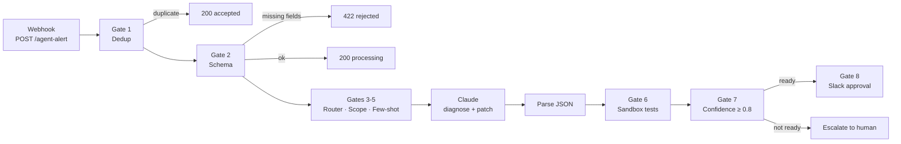

# AI Incident Agent · 8 Guardrail Gates

> An n8n workflow that turns a production alert into a tested, human-approved patch, with eight gates between the model and your codebase.


Built by [@SaiTarunRonanki](https://x.com/SaiTarunRonanki).

---

## Contents

- [How it works](#how-it-works)
- [The 8 gates](#the-8-gates)
- [Quick start](#quick-start)
- [Configuration](#configuration)
- [Alert payload](#alert-payload)
- [Webhook responses](#webhook-responses)
- [Customizing](#customizing)
- [Scaling to production](#scaling-to-production)
- [Troubleshooting](#troubleshooting)

---

## How it works



The model never writes to anything. It only proposes a diff, and that diff has to pass tests and a human before it goes anywhere.

---

## The 8 gates

| # | Gate | What it does | Why it matters |
|---|------|--------------|----------------|
| 1 | **Webhook Dedup** | Drops alerts with the same `alert_id` seen in the last 10 minutes | Stops alert storms from burning tokens |
| 2 | **Schema Gate** | Requires `alert_id`, `service`, `error`, `repo`; returns 422 otherwise | Bad input never reaches the model |
| 3 | **Model Router** | `critical` severity or errors over 800 chars go to `claude-sonnet-4-5`, the rest to `claude-haiku-4-5` | Pays for the strong model only when it's needed |
| 4 | **Tool Scope** | Passes a read-only allowlist (`git.blame`, `git.log`, `logs.search`) | No write access, ever |
| 5 | **Few-Shot Format** | Forces strict JSON with a unified-diff `patch` and a `confidence` score | Output is always machine-checkable |
| 6 | **Sandbox Verify** | Sends the patch to your sandbox to run tests (60s timeout) | Untested code doesn't reach a reviewer |
| 7 | **Confidence Gate** | Continues only if tests passed **and** confidence ≥ 0.8 | Unsure fixes go to a human instead |
| 8 | **Slack Approval** | Posts diagnosis + diff to `#incidents` and waits for a double-confirm approval | A person makes the final call |

---

## Quick start

1. **Download** [`ai-agent-8-gates.n8n.json`](./ai-agent-8-gates.n8n.json).
2. **Import** in n8n: *Workflows → Import from File*.
3. **Set environment variables** (see below) and restart n8n.
4. **Connect Slack** credentials on the *Gate 8 · Slack Approval* and *Escalate to Human* nodes.
5. **Activate** the workflow and send a test alert:

```bash
curl -X POST https://YOUR-N8N-HOST/webhook/agent-alert \
  -H "Content-Type: application/json" \
  -d '{
    "alert_id": "inc-1042",
    "service": "payments-api",
    "severity": "critical",
    "repo": "acme/payments",
    "error": "TypeError: Cannot read properties of undefined (reading amount) at src/pay.js:12"
  }'
```

---

## Configuration

| Variable | Required | Description |
|----------|----------|-------------|
| `ANTHROPIC_API_KEY` | Yes | Used by the *Claude (Diagnose + Patch)* node |
| `SANDBOX_URL` | Yes | Endpoint that applies a patch and runs tests. Receives `{ repo, patch, run: "tests" }`, must return `{ "passed": true \| false }` |

No keys or secrets are stored in the workflow file.

---

## Alert payload

| Field | Required | Type | Notes |
|-------|----------|------|-------|
| `alert_id` | Yes | string | Used for dedup |
| `service` | Yes | string | Shown in Slack |
| `error` | Yes | string | Stack trace or error message |
| `repo` | Yes | string | `owner/name`, passed to the sandbox |
| `severity` | No | string | `critical` routes to the stronger model |

---

## Webhook responses

| Case | Status | Body |
|------|--------|------|
| Duplicate alert | 200 | `{ "status": "accepted" }` |
| Missing fields | 422 | `{ "status": "rejected", "missing": [...] }` |
| Accepted for processing | 200 | `{ "status": "processing" }` |

The agent runs after the webhook has responded, so your alerting tool never waits on the model.

---

## Customizing

Each knob lives in one node, so changes stay small:

| Change | Node | Edit |
|--------|------|------|
| Dedup window | Gate 1 | `600000` ms |
| Required fields | Gate 2 | `required` array |
| Models / routing rule | Gates 3-5 | `model` expression |
| Allowed tools | Gates 3-5 | `allowedTools` array |
| Output format / examples | Gates 3-5 | `fewShot` string |
| Confidence threshold | Gate 7 | `>= 0.8` |
| Slack channel | Gate 8, Escalate | `#incidents` |

To add a gate, drop a Code node plus an IF node between any two existing gates. Each gate reads `$json` and passes it on with one extra field, so gates don't depend on each other.

---

## Scaling to production

- **Shared dedup:** Gate 1 uses n8n static data, which lives in one workflow instance. With queue mode or several workers, move dedup to Redis or your database.
- **Queue mode:** run n8n in queue mode so alert bursts are spread across workers.
- **Rate limits:** add a Wait or batching step before the Claude node if you get many alerts per minute.
- **Audit trail:** log every diagnosis, patch, confidence score, and approval decision to a table or sheet.
- **Errors:** attach an Error Workflow so a failed run still notifies `#incidents`.
- **Least privilege:** keep the tool allowlist read-only, and give the sandbox its own short-lived credentials.

---

## Troubleshooting

| Symptom | Likely cause |
|---------|--------------|
| 422 on every alert | Payload is missing one of the required fields |
| `Unparseable model output` in Slack | Model didn't return pure JSON; tighten the few-shot prompt |
| Everything escalates | Sandbox isn't returning `passed: true`, or confidence is under 0.8 |
| Slack node waits forever | Approval message wasn't answered; set a timeout on the node |

---

Questions or ideas? Find me on X: [@SaiTarunRonanki](https://x.com/SaiTarunRonanki)
