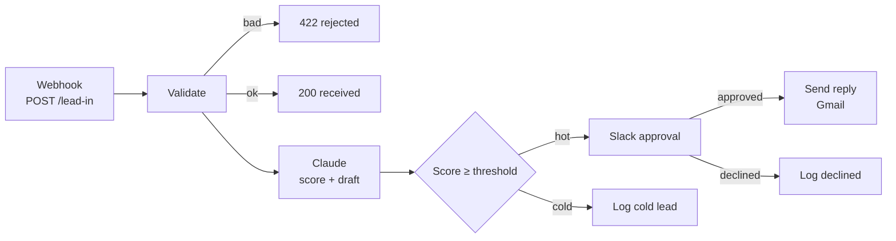

# Lead Approval Flow · AI scores, human approves

> Inbound lead in, Claude scores it and drafts a reply, and nothing gets sent until a person approves it in Slack.


Built by [@SaiTarunRonanki](https://x.com/SaiTarunRonanki).

---

## How it works



## What each step does

| Step | What it does |
|------|--------------|
| **Validate** | Checks email format and message, flags free-mail domains, trims long messages |
| **Score + Draft** | `claude-haiku-4-5` returns `{ score, reason, draft_reply }` as strict JSON |
| **Threshold** | Leads at or above `LEAD_SCORE_THRESHOLD` (default 70) go to review |
| **Slack Approval** | Shows the lead, the reason, and the draft; double-confirm; expires after 24h |
| **Send Reply** | Gmail sends the approved draft to the lead |

## Quick start

1. Import [`lead-approval-flow.n8n.json`](./lead-approval-flow.n8n.json) via *Workflows → Import from File*.
2. Set env vars below, then connect **Slack** and **Gmail** credentials.
3. Activate and test:

```bash
curl -X POST https://YOUR-N8N-HOST/webhook/lead-in \
  -H "Content-Type: application/json" \
  -d '{"name":"Priya","email":"priya@acme.io","company":"Acme","message":"Need help automating our support inbox","source":"website"}'
```

## Configuration

| Variable | Required | Description |
|----------|----------|-------------|
| `ANTHROPIC_API_KEY` | Yes | Claude scoring |
| `LEAD_SCORE_THRESHOLD` | No | Minimum score for review (default `70`) |

## Customizing

| Change | Node |
|--------|------|
| Scoring rules / reply tone | Build Prompt |
| Slack channel (`#leads`) | Slack Approval |
| Push to a CRM instead of email | Replace Send Reply with your CRM node |
| Approval timeout (24h) | Slack Approval → options |

## Scaling notes

- Add a dedup step on `email` if your form double-submits.
- Log every score and decision to a sheet or table to tune the threshold over time.
- Swap to `claude-sonnet-4-5` in Build Prompt's model only if scoring quality needs it.

No keys are stored in the workflow file. Questions? [@SaiTarunRonanki](https://x.com/SaiTarunRonanki)
