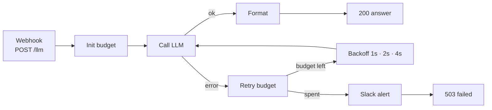

# LLM Retry Budget · backoff + model fallback

> One webhook for every LLM call. Failures retry with backoff, fall back to a cheaper model, and stop at a hard budget instead of looping forever.


Built by [@SaiTarunRonanki](https://x.com/SaiTarunRonanki).

---

## How it works



## The budget

| Rule | Default | Set with |
|------|---------|----------|
| Model per attempt | `claude-sonnet-4-5`, `claude-sonnet-4-5`, `claude-haiku-4-5` | `LLM_MODEL_CHAIN` (comma list) |
| Max attempts | length of the chain (3) | `LLM_MODEL_CHAIN` |
| Max total time | 45s | `LLM_MAX_TOTAL_MS` |
| Backoff | 1s, 2s, 4s, capped at 8s | Retry Budget node |

Attempt count comes from the node's own run index, so the budget holds per request with no shared state.

## Quick start

1. Import [`llm-retry-budget.n8n.json`](./llm-retry-budget.n8n.json).
2. Set `ANTHROPIC_API_KEY`, connect **Slack** on *Alert: Budget Spent*.
3. Call it:

```bash
curl -X POST https://YOUR-N8N-HOST/webhook/llm \
  -H "Content-Type: application/json" \
  -d '{"prompt":"Summarize this error log in one line: ...","max_tokens":300}'
```

## Responses

| Case | Status | Body |
|------|--------|------|
| Success | 200 | `{ status, answer, model, attempts, ms }` |
| Budget spent | 503 | `{ status: "failed", attempts, error }` |

## Customizing

- **Other providers:** put any model id in the chain and branch the *Call LLM* URL on it.
- **Retry only some errors:** in *Retry Budget*, set `give_up` on 400-type errors so bad prompts don't burn retries.
- **Use from other workflows:** call this webhook from an HTTP node, or convert the trigger to *Execute Workflow Trigger*.

## Scaling notes

- Keep `LLM_MAX_TOTAL_MS` under your caller's timeout.
- Log `model` and `attempts` from the 200 response to see how often fallback kicks in.

No keys are stored in the workflow file. Questions? [@SaiTarunRonanki](https://x.com/SaiTarunRonanki)
