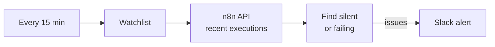

# Silence Alert · catch workflows that quietly stopped

> Errors are loud. A workflow that just stops running isn't. This checks every 15 minutes and pings Slack when something goes quiet, then again when it recovers.


Built by [@SaiTarunRonanki](https://x.com/SaiTarunRonanki).

---

## How it works



## What it flags

| Condition | Alert |
|-----------|-------|
| No successful run inside `max_silence_min` | 🔕 silent for N min |
| No successful run in recent history | 🔕 no successful run |
| Latest run failed | 🔕 latest run failed |
| Back to healthy after an alert | ✅ recovered |

Each problem alerts **once** until it recovers, so no spam every 15 minutes.

## Quick start

1. Import [`silence-alert.n8n.json`](./silence-alert.n8n.json).
2. In n8n, create an API key (*Settings → n8n API*).
3. Set env vars below and connect **Slack** on *Alert Slack*.
4. Edit the **Watchlist** node with your workflow IDs (from each workflow's URL):

```js
{ id: 'abc123', name: 'Lead intake', max_silence_min: 60 },
{ id: 'def456', name: 'Nightly sync', max_silence_min: 1500 },
```

## Configuration

| Variable | Required | Description |
|----------|----------|-------------|
| `N8N_BASE_URL` | Yes | e.g. `https://n8n.yourdomain.com` |
| `N8N_API_KEY` | Yes | n8n public API key |

## Customizing

| Change | Node |
|--------|------|
| Check frequency | Every 15 min |
| Which workflows and limits | Watchlist |
| Slack channel (`#alerts`) | Alert Slack |
| History depth (`limit=250`) | Get Executions |

## Scaling notes

- Watching many busy workflows? Raise `limit` or call the API once per workflow with `workflowId`.
- Run this on a different n8n instance than the ones it watches, so it still alerts if the main one goes down.

No keys are stored in the workflow file. Questions? [@SaiTarunRonanki](https://x.com/SaiTarunRonanki)
